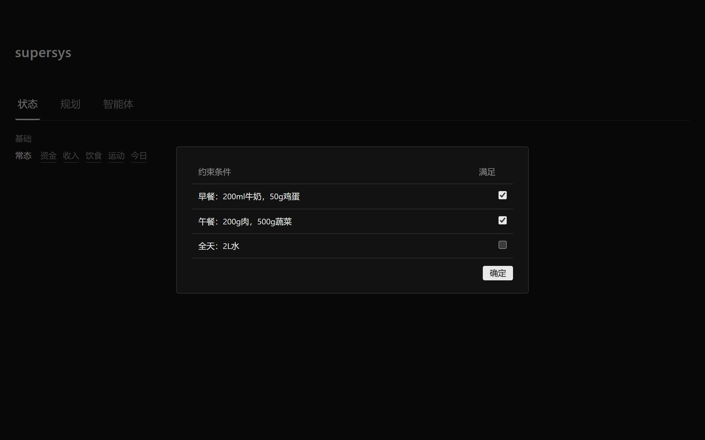
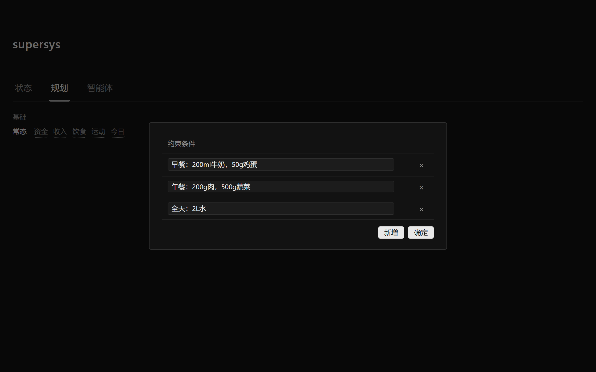
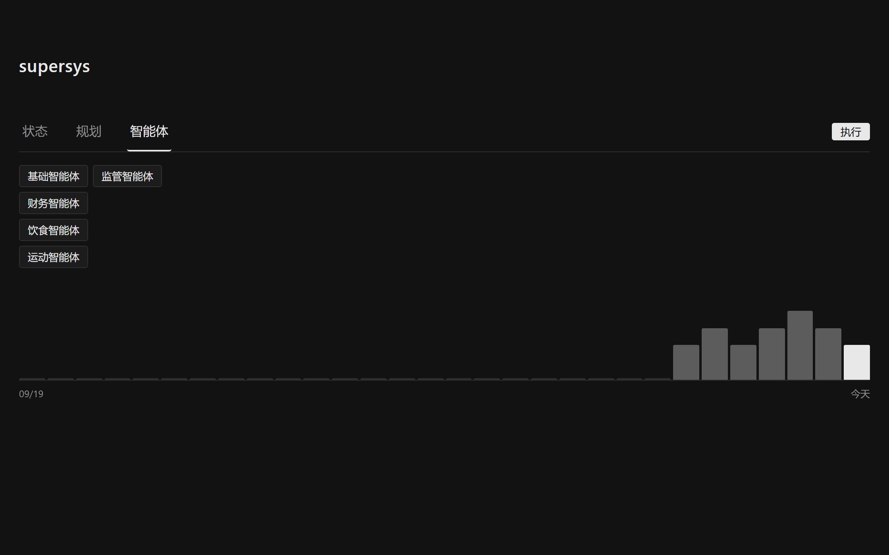
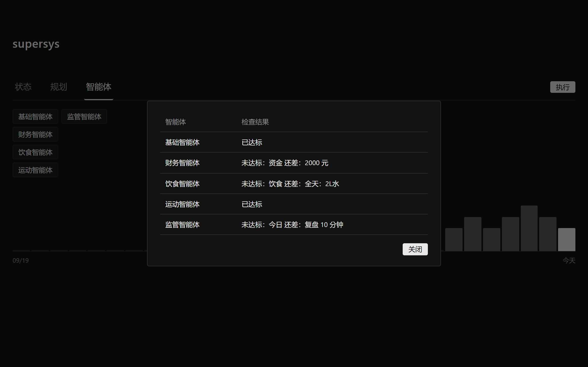
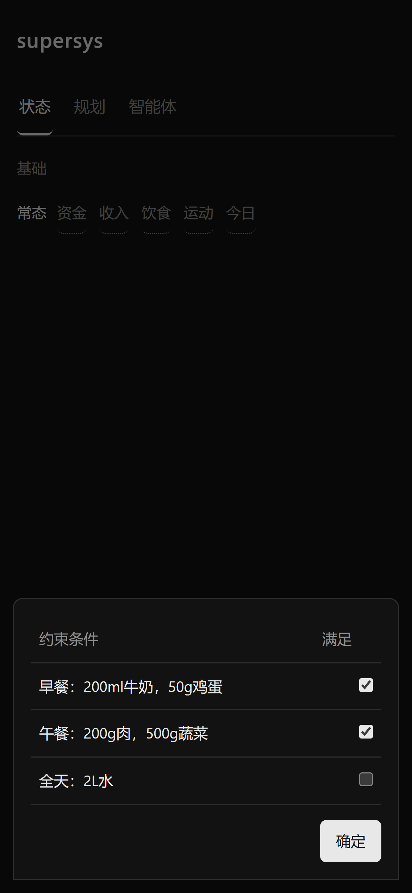
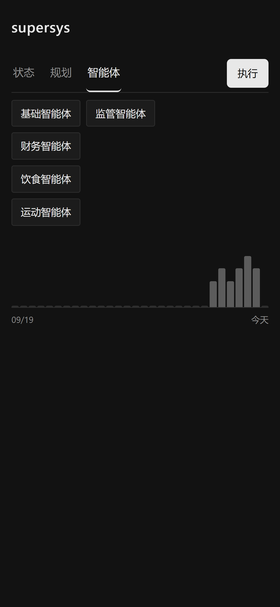

# supersys

[](https://github.com/wzqfwanj/supersys/releases/latest)
[](https://github.com/wzqfwanj/supersys/actions/workflows/release.yml)

> 极简的个人每日系统：把在意的事拆成「状态」和「规划」，「规划」里定条件，「状态」里勾选做到的事，每天点一次「执行」，让智能体检查今天有没有做到。

## 界面预览

| 状态 · 饮食勾选 | 规划 · 条件定义 |
| --- | --- |
|  |  |

| 智能体 + 每日统计 | 执行结果 |
| --- | --- |
|  |  |

移动端（Android App）也做了适配：

| 手机 · 状态 | 手机 · 智能体 |
| --- | --- |
|  |  |

## 功能

界面是深色的，只有一个窗口、几行文字和一张图，没有多余的东西；数据全部存在本地。

**状态 / 规划**，都分成「基础」和「常态」两部分：

- 基础：身高、体重
- 常态：资金、收入、饮食、运动、今日

「规划」里定义每项的约束条件（每一行一个条件），「状态」里勾选自己实际做到的，两边一一对应；「资金」「收入」是数字，规划填目标、状态填实际。

**5 个智能体**，点「执行」一键检查：

| 智能体 | 检查什么 |
| --- | --- |
| 基础智能体 | 身高、体重条件是否都勾选 |
| 财务智能体 | 实际资金 ≥ 目标资金、实际收入 ≥ 目标收入 |
| 饮食智能体 | 饮食条件是否都勾选 |
| 运动智能体 | 只检查**今天该做**的动作（运动条件可以按星期几安排） |
| 监管智能体 | 目前只监管「今日」这一项 |

- 没勾选 = 未达标，会列出还差哪些条件；全部满足显示「已达标」。
- 运动条件可以直接把星期写进文字里，例如：`高脚杯深蹲，一三五七`（支持 `一、三、五、七`、`周一、周三`、`每天`、`周末`、`工作日`、`周一到周五`、`1357`；不写周几 = 每天）。
- 每次「执行」会记一条当天记录（同一天多次执行保留最后一次），智能体页面下方是最近 30 天的统计图：每根柱 = 当天达标数 / 智能体数，柱子越高越好，鼠标悬停可看具体达标数。

**桌面版**：双击图标打开独立窗口（没有浏览器地址栏），关窗口会缩到右下角托盘，右键托盘可以「打开 supersys」或「退出」。

## 下载

两个客户端，都支持 **本地存储** 或 **云端存储**（二选一，互不同步）：

- **最新版**：<https://github.com/wzqfwanj/supersys/releases/latest>
- **PC 版（Windows）**：`supersys-pc.exe`（约 20 MB），双击运行，无需安装 Python 和依赖。第一次打开会先选「本地存储」还是「云端存储」。
- **移动端（Android）**：`supersys-mobile.apk`，装好后第一次打开选本地或云端；云端用手机号验证码登录。

说明：

- PC 版需要 Windows 10/11（自带 Edge WebView2 运行时）；
- 首次运行 SmartScreen 可能提示「Windows 已保护你的电脑」：点「更多信息」→「仍要运行」；
- 关窗口会缩到右下角托盘，右键托盘图标可「打开 supersys」或「退出」；
- 移动端首次安装需要允许「未知来源」安装。

两个客户端都由 GitHub Actions 自动打包：仓库里打一个 `v*` 标签（如 `v1.4.0`），
[release 工作流](.github/workflows/release.yml) 会构建 PC 版 exe 和移动端 APK 并自动发布到 Releases。

## 快速开始

需要 Windows + Python 3.10 以上（用到了 `sqlite3`、`http.server` 等标准库）。

```bash
git clone https://github.com/wzqfwanj/supersys.git
cd supersys
python -m pip install -r requirements.txt
```

**桌面版（推荐）**：双击桌面上的 `supersys` 图标，或运行 `启动supersys.bat`。第一次用可以先创建快捷方式：

```powershell
$ws = New-Object -ComObject WScript.Shell
$lnk = $ws.CreateShortcut("$env:USERPROFILE\Desktop\supersys.lnk")
$lnk.TargetPath = (Get-Command pythonw).Source
$lnk.Arguments = '"' + (Get-Location).Path + '\desktop.py"'
$lnk.WorkingDirectory = (Get-Location).Path
$lnk.IconLocation = (Get-Location).Path + "\web\icon.ico"
$lnk.Save()
```

## PC 版

- 双击 `supersys-pc.exe` 打开独立窗口（没有浏览器地址栏）；
- **第一次打开先选存储方式**：
  - 本地存储：数据存在 exe 旁边的 `data.db`；
  - 云端存储：填服务器地址 → 手机号验证码登录；
- 选择会记在 exe 旁边的 `desktop_config.json`（删掉这个文件可以重新选）：

  ```json
  { "mode": "local" }
  ```

  或

  ```json
  { "mode": "cloud", "url": "https://你的域名/supersys/" }
  ```

- 关窗口会缩到右下角托盘，右键托盘图标可「打开 supersys」或「退出」。

## 移动端

- 安装 `supersys-mobile.apk`，第一次打开先选存储方式：
  - **本地存储**：数据只存在这台手机上（App 私有目录），离线可用，不和云端同步；
  - **云端存储**：填服务器地址，手机号验证码登录，多设备同步；
- 页面右下角「⋯」可以随时切换存储方式；
- 登录后右上角「退出」可以退出登录。

## 手机号验证码登录

- 云端模式使用手机号 + 验证码登录；
- **目前是测试模式**：验证码直接显示在登录页（点「获取验证码」会自动填入），同时打印在服务器日志里，方便先跑通流程；
- 接真实短信：在服务器环境变量里配置阿里云短信（`SUPERSYS_SMS=aliyun` + `ALIYUN_SMS_KEY_ID`、`ALIYUN_SMS_KEY_SECRET`、`ALIYUN_SMS_SIGN`、`ALIYUN_SMS_TEMPLATE`），验证码就会通过短信发送；
- 测试阶段可以用 `SUPERSYS_ALLOWED_PHONES` 限定只允许指定手机号登录；`SUPERSYS_OWNER_PHONE` 决定现有数据归属到哪个手机号账号。

## 云端部署（多端随时可用）

把服务放到一台公网服务器上，手机 / 电脑都连它，就不用电脑一直开机了。

1. 服务器上（Python 3.8+）：

   ```bash
   mkdir -p /opt/supersys && cd /opt/supersys
   # 把 server.py 和 web/ 目录传上来
   cat > .env <<'EOF'
   SUPERSYS_CLOUD=1
   SUPERSYS_SMS=test
   SUPERSYS_OWNER_PHONE=你的手机号
   SUPERSYS_ALLOWED_PHONES=你的手机号
   EOF
   chmod 600 .env
   SUPERSYS_HOST=127.0.0.1 python3 server.py 8850
   ```

   建议用 systemd 常驻（`Restart=always`）。每个账号的数据在 `/opt/supersys/users/<id>.db`；`data.db` 是本地模式的数据，也是首个账号（`SUPERSYS_OWNER_PHONE`）迁移数据的来源。

2. 用 Caddy / Nginx 反代到 `127.0.0.1:8850` 并开 HTTPS。Caddy 示例（挂在已有域名下的子路径）：

   ```
   handle_path /supersys/* {
       reverse_proxy 127.0.0.1:8850
   }
   ```

3. 各端连接：

   - PC 版：第一次打开选「云端存储」，填 `https://你的域名/supersys/`；
   - 手机 APK：第一次打开选「云端存储」，填同一个地址；
   - 云端数据按手机号隔离，各端登录同一手机号即可看到同一份数据。

4. 接真实短信（可选）：环境变量设 `SUPERSYS_SMS=aliyun`，再配 `ALIYUN_SMS_KEY_ID`、`ALIYUN_SMS_KEY_SECRET`、`ALIYUN_SMS_SIGN`、`ALIYUN_SMS_TEMPLATE` 即可。

## 数据

- 本地模式：数据库 `data.db`（SQLite，和程序放在同一目录），第一次启动时如果存在旧的 `data.json` 会自动迁移进来。
- 云端模式：每个手机号账号一个独立数据库 `users/<id>.db`；`auth.db` 存账号、验证码、登录会话。
- 个人数据（`data.db`、`data.json`、`desktop.log`、`desktop_config.json`、`users/`、`auth.db`）都不会提交到仓库。
- 桌面版启动失败的日志在 `desktop.log`。

## 接口

| 方法 | 路径 | 说明 |
| --- | --- | --- |
| GET | `/api/sections` | 分区 / 智能体列表 |
| GET | `/api/session` | 当前登录状态 / 手机号 |
| POST | `/api/auth/request-code` | 获取验证码 `{phone}` |
| POST | `/api/auth/verify` | 校验验证码登录 `{phone, code}` |
| POST | `/api/auth/logout` | 退出登录 |
| GET | `/api/plan`、`/api/status` | 规划 / 状态数据 |
| GET | `/api/runs` | 每天的执行记录 |
| POST | `/api/runs` | 保存今天执行结果 `{results}` |
| POST | `/api/plan/items`、`/api/status/items` | 新增条件 `{field, name}` |
| PATCH | `/api/plan/items/<id>`、`/api/status/items/<id>` | 修改条件 `{name}` |
| DELETE | `/api/plan/items/<id>`、`/api/status/items/<id>` | 删除条件 |
| POST | `/api/plan/batch`、`/api/status/batch` | 一次提交多条改动 |
| POST | `/api/plan/amounts`、`/api/status/amounts` | 保存数字字段 `{field, amount}` |
| GET | `/api/health` | 健康检查 |

条件在数据库里是**一行一条**，新增 / 改名 / 删除都是单行操作，所以开多个窗口同时改也不会互相覆盖。

## 项目结构

```
desktop.py       桌面版入口（原生窗口 + 托盘 + 本地/云端存储选择）
启动supersys.bat  无控制台启动桌面版
server.py        后端（静态资源 + SQLite + 手机号登录 + 每用户独立数据库）
web/index.html   页面骨架
web/styles.css   极简样式（含手机端适配）
web/app.js       三个分区的交互、智能体判断、统计图、本地存储模式
web/icon.ico     应用图标
android/         Android 客户端工程（本地/云端存储选择、本地数据桥）
.github/workflows/release.yml  打标签自动打包 PC + 移动端并发版
docs/            界面截图
requirements.txt 桌面版依赖
desktop_config.example.json  云端连接配置示例
data.db          SQLite 数据库（运行后生成，不提交）
```

## 开发

- 默认分支 `main`，开发分支 `dev`。
- 提交推送：
  ```bash
  git add -A
  git commit -m "改了什么"
  git push
  ```
- 如果直连 GitHub 超时，可以给 git / gh 配本地代理，例如：

  ```bash
  git config http.proxy http://127.0.0.1:7897
  # gh 用环境变量（PowerShell）：
  $env:HTTPS_PROXY = "http://127.0.0.1:7897"
  ```
- **发新版本**（自动打包 + 发布 exe）：
  ```bash
  git tag v1.1.0
  git push origin v1.1.0
  ```
  推送标签后，GitHub Actions 会自动构建 Windows exe 并发布到 Releases；也可以在 Actions 页面手动触发（只产出一个构建产物，不发版）。

## 许可

[MIT License](LICENSE)

